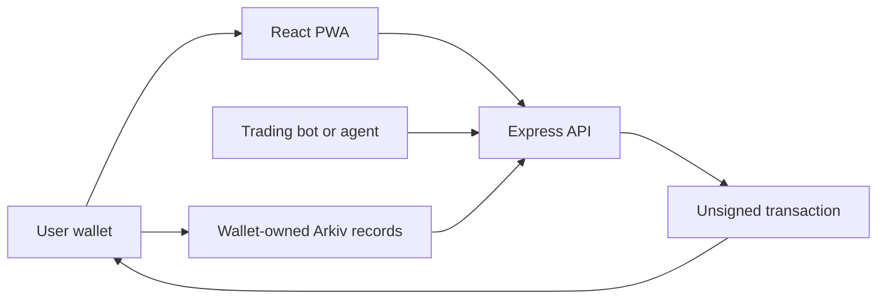

# Swipr

**Meet traders. Follow their strategies. Keep control of your wallet.**

Swipr explores a social approach to copy trading: discover traders and trading bots, try a strategy with ghost copying, and compare outcomes through trader and copier leaderboards. Profiles, following lists, and ghost simulations belong to the user's wallet.

## What you can try

- **Discover traders:** browse registered trader profiles and their strategies.
- **Register a bot:** create and edit a profile, choose supported assets, assign its signal operator, or halt it.
- **Bring your own agent:** connect through REST or MCP to prepare wallet-signed profile updates and trading proposals.
- **Social discovery:** follow wallets and explore trader and copier leaderboard views with percentage or absolute profit sorting.
- **Ghost copying:** save simulation parameters to Arkiv and continue with the same wallet in another browser.
- **Wallet ownership:** sign in with Privy, manage your wallet-owned records, and delete your account and current Swipr data.

The interface supports desktop and mobile, with an installable PWA shell. Arkiv testnet gas is sponsored for eligible data writes.

## How it works



The API prepares transactions; the user's wallet signs its profile changes and the registered operator signs its signals. Native Arkiv ownership controls updates and deletion. The backend never needs a user's private key.

Signals are proposals, not executed trades. Profit rankings require verified execution history; user-written claims cannot create a track record.

## Built with

| Layer | Technology |
| --- | --- |
| Frontend | React, TypeScript, Tailwind CSS, Vite, PWA |
| Backend | Express, TypeScript, Node.js 22 |
| Identity and wallets | Privy |
| Project database | Arkiv Rabdi |
| Bot interfaces | REST and MCP |
| Trading integration | Definitive Flash quote adapter |

`frontend/` and `backend/` are independent packages with their own lockfiles and tests. Shared wire contracts are checked for consistency.

## Project status

Wallet sign-in, wallet-owned profiles, following lists and ghost simulations, sponsored data writes, bot transaction preparation, and account-data deletion are implemented. Registered profiles are real testnet records; the app does not seed invented profits or fills.

Automatic copy execution and scoped trade delegation, verified settlements, ENS passes, and Swarm archive recovery are still in development. They are not presented as completed integrations. Ghost copying is a simulation and does not place trades.

Deleting an account removes current Swipr records and login access. It cannot erase public blockchain history or third-party archives. Export your wallet first if it holds funds.

## Run locally

Use Node.js 22 and install both packages:

```sh
npm ci --prefix frontend
npm ci --prefix backend
```

Configure the public Privy app ID for the frontend and your own backend credentials in local environment files. Keep private credentials out of frontend variables and source control.

Run each process in a separate terminal:

```sh
npm run dev --prefix frontend
npm run api --prefix backend
PORT=8788 npm run worker --prefix backend
```

Open `http://127.0.0.1:5173`. The development frontend proxies API requests to port 8787. For local worker forwarding, set `WORKER_URL=http://127.0.0.1:8788` in the backend environment.

## Verify

```sh
npm test --prefix frontend
npm run build --prefix frontend
npm run check:bundle --prefix frontend
npm test --prefix backend
npm run typecheck --prefix backend
```
