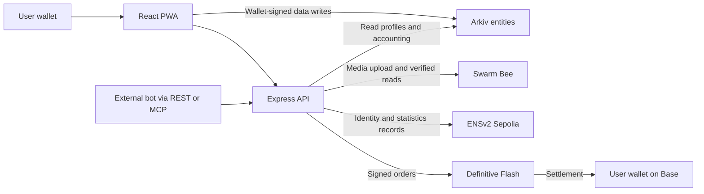

# Swipr

**Meet your next trader. Try their strategy. Copy with limits you control.**

Swipr is a social copy-trading app for people who want to discover traders and trading bots before committing funds. Browse a profile, follow its wallet, try a hypothetical ghost portfolio, or join a Copy Pass. Compare both sides of the relationship through trader and copier leaderboards, including a Following view for your own circle.

[**Open the live app**](https://swipr-web.onrender.com) · [**Watch the demo on X**](https://x.com/vikings_ace/status/2118908376545648961) · [MIT license](LICENSE) · Built for ETHGlobal Mumbai

## For judges

- **Arkiv criteria:** [Why Arkiv](arkiv/why-arkiv.md), [how it is used](arkiv/how-you-use-arkiv.md), [schema and ownership](arkiv/schema.md), [builder feedback](arkiv/friction.md), [reach and actual rehearsal usage](arkiv/reach.md).
- **Arkiv + Swarm bonus:** [real entity/reference, postage purchase, upload/read steps and demo timestamp](arkiv/swarm.md).
- **Execution evidence:** [confirmed trader entry, automatic copy and reviewed closing sale](#confirmed-onchain-demo-evidence).
- **Identity evidence:** [ENSv2 subname, permissions and record verification](#ensv2-an-identity-with-verifiable-records).

## The product in one flow

1. **Discover:** read a trader's strategy, supported assets and available history. Trader and bot profiles display their ENS identity when available.
2. **Ghost copy:** track hypothetical entries and exits without spending funds. Saved settings belong to your wallet and restore across browsers.
3. **Match:** join an available public seat immediately; no trader acceptance is required. Private seats are reserved for wallets the trader invites.
4. **Set your boundaries:** choose a per-trade amount, trade count and duration. Reviewed copying requests an order signature; automatic copying requires an explicit, expiring wallet permission and bounded token allowance.
5. **Inspect the outcome:** open confirmed fills and their Base explorer receipts, compare percentage returns or absolute profit, close a position and unmatch.

Traders can register their own bot, upload a portrait, assign a signal operator, manage public/private seats and connect through **REST or MCP**. A bot proposal does not count as a fill or create leaderboard performance.

The React PWA supports desktop and mobile. Sign-in uses the full Privy login dialog. Users control their Arkiv records and can delete their current app data before removing their login.

## Sponsor integrations at a glance

| Integration | What users get | What to inspect |
| --- | --- | --- |
| **Definitive Flash** | Real limit orders and automatic copy entries into each copier's own wallet | Shared limit/expiry checks, bounded permissions and confirmed Base receipts |
| **ENSv2** | A resolvable identity for a trader or bot, with profile and recent statistics records | Wallet-owned subnames, dedicated Permissioned Resolvers and narrowly delegated text setters |
| **Arkiv** | Wallet-owned profiles, follows, ghosts and Copy Pass records | Native ownership, indexed queries, chosen expirations and durable execution accounting |
| **Swarm** | Uploaded bot/profile images referenced by their content address | An Arkiv profile's `image` field, Bee upload/readback and BMT integrity verification |

These correspond to the [Definitive social trading](https://ethglobal.com/events/mumbai/prizes/definitive), [ENSv2](https://ethglobal.com/events/mumbai/prizes/ens) and [Build on Arkiv / Arkiv + Swarm](https://ethglobal.com/events/mumbai/prizes/arkiv) tracks. The implementation below describes shipped behavior; the original research specification is not a list of completed features.

### Definitive Flash: social trading with an execution boundary

The social relationship becomes a real order through Flash. A copy requires a confirmed trader fill and reuses its **limit price and remaining expiry window**. Expired source orders are rejected before requesting a wallet signature. Sharing a limit does not guarantee identical execution prices.

- The current entry flow uses **5 USDC limit buys on Base**, with WETH and cbBTC supported subject to the trader's asset settings. Reviewed limit sells and cancellation of the wallet's own resting orders are also implemented.
- Swipr charges an integrator fee of **10 bps (0.1%) of each trade**, through Definitive. This is separate from the trader's pass-level profit share.
- Automatic entries require a wallet-owned pass, an expiring Privy signer grant and bounded USDC approval. The entry policy excludes transfers, wallet export and arbitrary signing; the owner can revoke it.
- The engine reserves pass budget and trade count in Arkiv before submission. A pass/source pair cannot be copied twice, and ambiguous provider responses retain their reservation until reconciled.
- Wallet history checks successful Base receipts, token movements and at least two confirmations. Pending orders and unverified responses never become confirmed performance.
- Reviewed cashouts sell pass inventory with a **1% maximum slippage**. Automatic exits need a separate permission limited to the pass's inventory.

**Code:** [execution and receipts](backend/trading/service.ts), [Flash adapter](backend/providers/flash.ts), [copy accounting](backend/trading/accounting.ts), [signer policy](backend/automation/policy.ts), [pass lifecycle](backend/trading/pass-manager.ts).

### ENSv2: an identity with verifiable records

A Swipr trader or bot receives a service-paid subname under **`swipr.eth` on Sepolia**. Each identity has a dedicated Permissioned Resolver and is assigned to the profile owner's wallet. The user does not need to buy a separate root name.

The resolver publishes `swipr.profile`, `swipr.stats` and `swipr.updatedAt`. These link the identity to its Arkiv profile, recent receipt-verified wallet activity and snapshot time. Ethereum and Base address records point to the trader's wallet.

**Enhanced Access Control is part of the integration:** after setup, the publisher's root resolver roles are removed and it retains setters for only those three text keys. The owner can revoke publication. Verification reads ownership, expiry, address resolution, snapshot freshness and correspondence with the underlying profile and confirmed fills.

Example: [`trader-a3288fdb4b7b4200.swipr.eth`](https://sepolia.app.ens.domains/trader-a3288fdb4b7b4200.swipr.eth). A confirmed [record publication transaction](https://sepolia.etherscan.io/tx/0x722e174a2be1c7de42a839aa5f5cc69016cb8531f1b438bbf478eb1e395a70dd) is available on Sepolia.

**Code:** [registrar and role delegation](backend/ens/registrar.ts), [record comparison](backend/ens/records.ts), [receipt-backed statistics](backend/ens/stats.ts), [ENS interface](frontend/src/components/EnsProfile.tsx).

Statistics disclose their latest-20-orders scope and pagination. They describe wallet activity, not proof that a specific bot generated every order. The parent namespace remains administered by Swipr; these are not emancipated or permanent names.

### Arkiv: the application's database, with wallet ownership

Arkiv Rabdi stores the data that powers the app, using `@arkiv-network/sdk`. Profiles, follows, saved ghosts, invitations and Copy Pass records are read back into user-facing screens. Native **`$owner`**, rather than an owner string inside JSON, controls who can update or delete a user's entities.

| Data | Ownership and lifetime | Visible effect |
| --- | --- | --- |
| Profiles and following lists | User wallet; created with 30-day expiration | Restore the same profile and social graph across browsers |
| Saved ghosts | User wallet; 30-day entity lifetime, with a separate simulation window of at most 7 days | Resume a hypothetical portfolio without local-only state |
| Seats and invitations | Copier/trader wallet respectively; created with 90-day expiration | Public capacity, wallet-specific invitations and bounded pass terms |
| Execution journal | Service wallet; readonly events with 180-day expiration and renewal support | Restore budget reservations and reconcile uncertain submissions after restart |

**Why Arkiv matters here:** users' edit and delete authority is enforced by the storage protocol, and another client can query the same public entities by project, schema or wallet. Swipr's API is not the only holder of the social graph. Replacing this with an ordinary server database would put those permissions and read access entirely behind the application's server.

Swipr sponsors bounded **tGLM funding** for eligible data writes; the user's wallet still authorizes the data transaction. Account deletion checks that current records are removed before deleting the Privy login. Blockchain history, service-owned accounting records, public ENS snapshots and distributed media are not erased by deleting a profile.

**Public rehearsal writers:** trader `0x11d7a223c96045b9B4C90d5907246cf86437F105`; copier `0xd5Dda1882302b3496922D1858C4386FE0eC3244d`. The operational journal/funding writer is `0x38ec73c5a31e444b3Eca9393b6b0d5191720b310`. These are team-operated test accounts, not external adoption figures.

Run this read-only query against Rabdi to inspect the trader's current profile and native owner:

```sh
curl -sS https://rpc.rabdi.db-chain.testnet.arkiv.network \
  -H 'content-type: application/json' --data-binary @- <<'JSON'
{
  "jsonrpc": "2.0",
  "id": 1,
  "method": "arkiv_query",
  "params": [
    "project = str('swipr-mumbai26') AND arkiv.schema = str('swipr.wallet-profile.v1') AND $owner = addr(0x11d7a223c96045b9b4c90d5907246cf86437f105)",
    {"limit": "0x5", "select": {"key": true, "owner": true, "expiresAt": true, "attributes": true}}
  ]
}
JSON
```

The response includes entity keys, native owners, expiration blocks and attributes; the `profile` bytes attribute contains the JSON profile. Results reflect current records, so a subsequently deleted or expired profile will not be returned.

Secrets and signing permissions stay out of public entities. Flash supplies current quotes and chain receipts; Swarm stores media bytes; ENS publishes the current identity snapshot.

**Code:** [schemas](backend/contracts/wallet-profile.ts), [wallet-signed writes](frontend/src/lib/arkiv.ts), [ghost reconstruction](backend/ghosts/wallet.ts), [seat validation](backend/passes/seats.ts), [event journal](backend/arkiv-journal.ts), [account deletion](backend/account.ts).

### Swarm: the media, linked from Arkiv

Swarm stores the actual uploaded portraits users see. The browser crops and re-encodes an upload as a bounded static WebP; the authenticated API uploads it through Bee, verifies its **BMT file address**, reads it back and returns a `bzz://` reference. Saving the profile places that reference in the wallet-owned Arkiv entity's **`profile.image`** field. Public image reads verify the content address again.

One real connection between the two systems:

- **Arkiv profile entity:** `0x590d444773afe232de63eaaff8ef8803940f3d34b80ea1fbfe62d11179281f8a`
- **Stored image reference:** `bzz://222ffe30c36fd0fabaa270e155b2f12c2553e62e16335d40f0b6a343792f9ff3`
- **Where to see it:** the bot portrait in [Discover](https://swipr-web.onrender.com/#discover), its Bot studio editor and the ENS `swipr.profile` record above. In the 2:49 demo, the media section begins at **2:21**.

Bee uploads use the platform's postage batch and request pinning. Availability depends on postage and network operation. Public media can remain distributed after a profile removes its reference. This integration does not claim permanent storage, encrypted private media, an independent trading archive or a Swarm-hosted frontend.

**Code:** [portrait processing](frontend/src/lib/profile-images.ts), [upload/read validation](backend/media.ts), [Bee adapter and BMT verification](backend/providers/bee.ts), [media tests](backend/media.test.ts).

## Confirmed onchain demo evidence

| Rehearsal step | Public receipt | Verified result |
| --- | --- | --- |
| Trader limit entry | [Base transaction](https://basescan.org/tx/0xe06eea393d5cf16c5fda24463b72033aa5ac6b795c069af5c7a443890675c1ab) | 5 USDC spent; 0.002238516007794932 WETH received |
| Automatic copier entry | [Base transaction](https://basescan.org/tx/0x008896d33c95ad1dd244b014bc5f7a68fe189f5b0abaacca94f87e8afbd821cb) | 5 USDC spent; 0.002237640703315144 WETH received |
| Copier's reviewed closing sale | [Base transaction](https://basescan.org/tx/0x2bc68f8f28a61a9f7e064f3cc11d914f919e688205ba89ff24bde200e68f48df) | That WETH sold for 4.958057 USDC |

Both entries used a $2,250 limit and the 0.1% integrator fee. The automatic-entry rehearsal used a local execution worker while the copier was signed out; the deployed app displays the confirmed receipts. Another copy was rejected after the one-trade allowance was consumed, and the owner later revoked the signer.

These are real, team-funded rehearsal transactions. They demonstrate bounded entry automation and a reviewed closing sale, **not profitable performance or a completed automatic-exit rehearsal**. The original research's Copy Pass ENS names, Agent Charters, emancipated identities, sealed trade archives and Swarm recovery frontend remain outside the shipped demo.

## Performance and control

- Trader/copier rankings reconstruct FIFO round trips from available Flash history and verified Base receipts. Execution fees are reflected in wallet cash flows; outside trades and separately paid profit share are excluded. Open buys do not establish realized profit, and incomplete history is unavailable rather than invented.
- Ghost portfolios are hypothetical and excluded from real rankings. Their settings are stored on Arkiv; their results are reconstructed from verified wallet fills.
- Pass settlement implements a separate **5% trader share of positive realized pass profit**, waived below $0.05. Automated exit and settlement paths have test coverage; live automated exits and a positive-profit settlement transfer have not been demonstrated by the receipts above.
- Users can revoke automation, halt a bot, close positions and delete current wallet-owned records. Export a funded wallet before deleting its login.

## Architecture and stack



**Frontend:** React, TypeScript, Tailwind CSS, Vite and PWA. **Backend:** Express, TypeScript and Node.js 22. **Wallets:** Privy and viem. `frontend/` and `backend/` are independent packages with separate lockfiles and tests; shared wire contracts are checked for consistency.

AI coding tools assisted with research, implementation, tests, debugging and demo preparation. Test accounts and funded rehearsal activity are identified above; no user adoption or profitable track record is claimed from them.

## Run locally

Use Node.js 22. Install both packages and configure your own credentials using [.env.example](.env.example). Private credentials belong only in local/backend environment files, never frontend variables or source control.

```sh
npm ci --prefix frontend
npm ci --prefix backend
```

Run these in separate terminals:

```sh
npm run dev --prefix frontend
npm run api --prefix backend
PORT=8788 npm run worker --prefix backend
```

Open `http://127.0.0.1:5173`. The development frontend proxies API requests to port 8787; set `WORKER_URL=http://127.0.0.1:8788` for local execution-worker forwarding. Real writes and trades require the configured integrations and wallet authorization.

## Verify

```sh
npm test --prefix frontend
npm run build --prefix frontend
npm run check:bundle --prefix frontend
npm test --prefix backend
npm run typecheck --prefix backend
```
