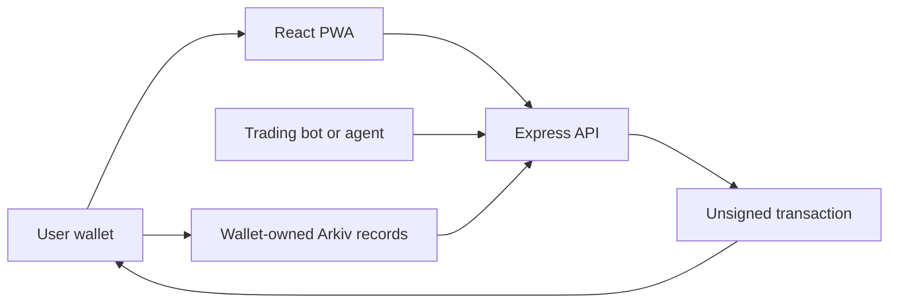

# Swipr

**Meet traders. Follow their strategies. Keep control of your wallet.**

Swipr explores a social approach to copy trading: discover traders and trading bots, try a strategy with ghost copying, and compare outcomes through trader and copier leaderboards. Profiles, following lists, and saved ghost settings belong to the user's wallet.

## What you can try

- **Discover traders:** browse registered trader profiles and their strategies.
- **Register a bot:** create and edit a profile, choose supported assets, assign its signal operator, or halt it.
- **Bring your own agent:** connect through REST or MCP to prepare wallet-signed profile updates and trading proposals.
- **Social discovery:** follow wallets and explore trader and copier leaderboard views with percentage or absolute profit sorting.
- **Copy Pass seats:** join available public seats immediately, or use a trader’s private invitation. Traders control public and private capacity; copiers own their pass records. Trading permissions are separate.
- **Ghost copying:** save simulation parameters to Arkiv and continue with the same wallet in another browser.
- **Wallet ownership:** sign in with Privy, manage your wallet-owned records, and delete your account and current Swipr data.

The interface supports desktop and mobile, with an installable PWA shell. Arkiv testnet gas is sponsored for eligible data writes.

## How it works



The API prepares transactions; the user's wallet signs its profile changes and the registered operator signs its signals. Native Arkiv ownership controls updates and deletion. The backend never needs a user's private key.

Signals are proposals, not executed trades. Profit rankings require verified execution history; user-written claims cannot create a track record.

## Built with

| Layer | Technology |
| --- | --- |
| Frontend | React, TypeScript, Tailwind CSS, Vite, PWA |
| Backend | Express, TypeScript, Node.js 22 |
| Identity and wallets | Privy |
| Project database | Arkiv Rabdi |
| Profile and bot media | Swarm (Bee, Sepolia testnet) |
| Bot interfaces | REST and MCP |
| Trading integration | Definitive Flash |
| Trader identity and published records | ENSv2 on Sepolia |

`frontend/` and `backend/` are independent packages with their own lockfiles and tests. Shared wire contracts are checked for consistency.

## Sponsor integrations and judging highlights

Swipr connects identity, user-owned social data and real execution. ENS publishes a trader's current identity and records; Arkiv stores the application's persistent records; Definitive executes wallet-signed orders. Swarm stores profile and bot media; independent trading archives remain a separate roadmap item. The sections below distinguish the working integration from the research roadmap.

### ENSv2 — a trader identity anyone can verify

**Talking point:** “Resolve the trader's name, then check the wallet and the records behind it.”

- Traders receive service-paid subnames under `swipr.eth` on Sepolia, assigned to their own wallets with dedicated resolvers. They do not need to register a separate root name.
- `swipr.profile`, `swipr.stats` and `swipr.updatedAt` publish the current profile, receipt-verified wallet activity and snapshot time. Address records bind the identity to the trader's wallet.
- Swipr's publisher has permission to update only those three text records. The trader can revoke that permission. Verification checks ownership, expiry, address resolution, freshness and correspondence with Arkiv and confirmed settlements.
- Stats cover the latest 20 wallet orders and disclose pagination. They are wallet-level evidence, not proof that a particular bot generated every trade; open buys do not establish realized profit.

**Show the judges:** open a trader's ENS details, inspect its profile and fill references, and compare the resolved owner with the wallet that owns its Arkiv profile. See the [registrar](backend/ens/registrar.ts), [record comparison](backend/ens/records.ts) and [receipt-backed stats](backend/ens/stats.ts).

ENS Copy Pass names, Agent Charters and emancipated “Forever” identities remain roadmap items. Swipr currently retains administration of the parent namespace.

### Arkiv — social records owned by the people who create them

**Talking point:** “Your profile, following list, ghost settings and Copy Pass records belong to your wallet.”

- Arkiv Rabdi is the project database for profiles, social relationships, ghost settings and public or invited private seats. Native `$owner` determines who can update or delete a user's records.
- The backend prepares user transactions and sponsors bounded tGLM funding for eligible writes; the user's wallet authorizes the actual data change. Reloading or signing in from another browser restores records from Arkiv.
- Operational events use a separate readonly, service-owned Arkiv journal with revision and writer checks. User-controlled records and operational history have distinct ownership.
- Account deletion removes current wallet-owned application records before removing the Privy login. It does not erase historical chain transactions or public ENS snapshots.

**Show the judges:** save a following list or ghost, reload, inspect its native owner, and demonstrate an approved edit or deletion. A rejected signature leaves the record unchanged. See the [wallet ghost reader](backend/ghosts/wallet.ts) and [Arkiv event journal](backend/arkiv-journal.ts).

Saved ghosts restore wallet-owned parameters and derive hypothetical fixed-size entries and proportional exits from receipt-verified Flash wallet fills during the ghost window. Open assets are unpriced; simulated outcomes are excluded from real rankings. A complete sealed trade/exit archive remains separate work.

### Definitive Flash — copy a real order under the same limit

**Talking point:** “The copier uses the trader's limit price and remaining order window, with settlement into the copier's own wallet.”

- The implemented tap-copy flow submits reviewed 5 USDC limit buys on Base through Definitive Flash. Wallets can also review limit sells back to USDC and sign cancellation requests for their own resting orders. Supported assets are WETH and cbBTC, subject to the trader's enabled assets.
- A copy requires a confirmed matching trader fill and inherits its limit and expiry. An expired source window is rejected before requesting a wallet signature. A shared limit does not imply identical actual execution prices.
- Quotes bind the reviewed fields, wallet signatures are verified, and approvals are checked for exactly 5 USDC on buys or the reviewed asset amount on sells. Swipr's integrator fee is **10 bps (0.1%) per trade**, not a percentage of profit.
- Wallet history checks successful Base receipts and token movements with at least two confirmations. An order proposal or pending provider response is never displayed as a confirmed fill.

**Show the judges:** compare the completed [trader buy](https://basescan.org/tx/0x357532ba9b39b71e079a882d362a9b60ae5bd6d6d6f90d32c65f04d224946f14) and [copier buy](https://basescan.org/tx/0x570171b7b506492de5060fa70436695919bf8deaaf8fb897231a1d18303b32ac), then reload wallet history. Both spent 5 USDC; their WETH proceeds differ. These are team-operated rehearsal trades, not evidence of external adoption or profitable performance. See the [execution and receipt checks](backend/trading/service.ts).

Automatic copying, scoped delegation, cumulative pass accounting, protected exits and shared exit fan-out remain unfinished. The current supported path requires reviewed wallet signatures.

### Swarm — content-addressed platform media

**Talking point:** “The image lives on Swarm; the profile and its owner live on Arkiv.”

- New trader and bot portrait uploads are cropped and re-encoded as small static WebP images, then uploaded through Bee using the platform's postage batch. The wallet-owned Arkiv profile stores a `bzz://` content reference instead of the image bytes.
- Uploads require an authenticated linked wallet. The API bounds file size and dimensions, checks the Swarm BMT file address and reads the image back before returning its reference. Public image reads verify the address again before serving the bytes.
- Images are pinned on the platform's Bee node. Postage funds a storage period; availability depends on stamp validity and network operation, not a promise of permanent storage. Removing a profile reference does not erase copies of public media already distributed on Swarm.
- Existing inline portraits remain readable, and bundled illustrations keep the interface usable if media is temporarily unavailable. ENS profile records can include the same image reference.

**Show the judges:** upload a portrait in Bot studio, save the wallet-owned profile, reload, then compare its `bzz://` reference with the image request's `X-Swarm-Reference` and `X-Swarm-Integrity: verified` headers. See the [media service](backend/media.ts), [Bee adapter](backend/providers/bee.ts) and [portrait upload flow](frontend/src/lib/profile-images.ts).

Hash-chained trading archives and a frontend hosted entirely on Swarm remain roadmap items; media storage does not establish those recovery capabilities.

## Project status

Wallet sign-in, wallet-owned profiles, following lists, stored ghost settings, public and invite-only Copy Pass seats, sponsored data writes, bot transaction preparation, and account-data deletion are implemented. Reviewed tap-copy orders support 5 USDC limit buys on Base, asset-denominated limit sells and wallet-signed cancellation, with a 0.1% platform fee, exact token approvals, and receipt-verified wallet history. Registered profiles are real testnet records; the app does not seed invented profits or fills.

Automatic copying and scoped trade delegation, cumulative pass budget/trade-count enforcement, protected and shared exits, ENS Copy Pass minting, and Swarm archive recovery are still in development. Ghost settings do not place trades. Trader and copier rankings reconstruct FIFO round trips from complete available Flash wallet order history and verified Base receipts. Execution fees are included in wallet cash flows; outside trades and separately paid profit share are excluded. Roles identify registered trader wallets and seat holders, not bot-specific attribution. Missing history produces an unavailable state; open buys produce no realized profit.

Deleting an account removes current Arkiv records and login access. Public ENS snapshots, blockchain history and distributed media or third-party archives may remain public. Export your wallet first if it holds funds.

## Run locally

Use Node.js 22 and install both packages:

```sh
npm ci --prefix frontend
npm ci --prefix backend
```

Configure the public Privy app ID for the frontend and your own backend credentials in local environment files. Keep private credentials out of frontend variables and source control.

Run each process in a separate terminal:

```sh
npm run dev --prefix frontend
npm run api --prefix backend
PORT=8788 npm run worker --prefix backend
```

Open `http://127.0.0.1:5173`. The development frontend proxies API requests to port 8787. For local worker forwarding, set `WORKER_URL=http://127.0.0.1:8788` in the backend environment.

## Verify

```sh
npm test --prefix frontend
npm run build --prefix frontend
npm run check:bundle --prefix frontend
npm test --prefix backend
npm run typecheck --prefix backend
```
